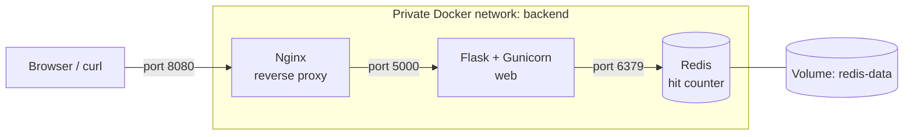
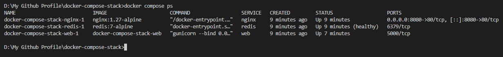
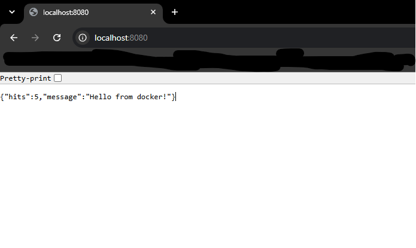
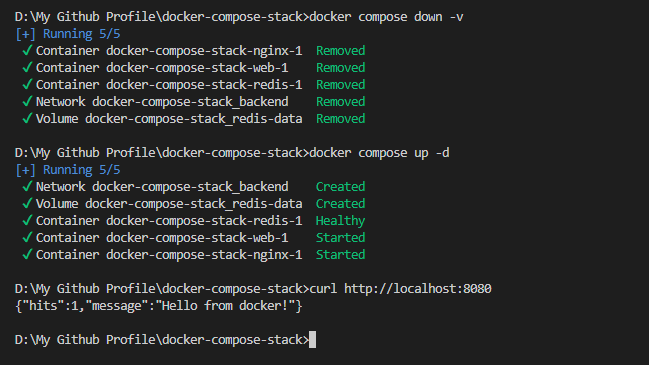
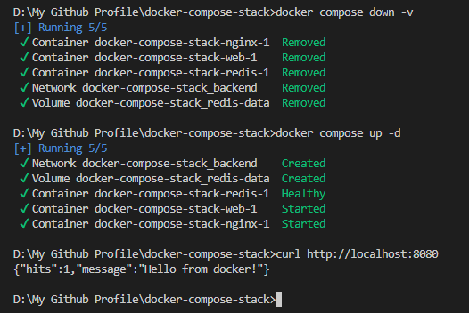

# Docker Compose Stack: Flask + Redis + Nginx

A three-container application run with Docker Compose. Nginx is the only public entry point, Flask serves the API, and Redis stores a hit counter that survives restarts.

## Architecture



| Service | Image | Role | Published port |
|---------|-------|------|----------------|
| `nginx` | `nginx:1.27-alpine` | Reverse proxy, receives all outside traffic | `8080` |
| `web` | Built from `Dockerfile` | Flask app served by Gunicorn | none (internal only) |
| `redis` | `redis:7-alpine` | Stores the hit counter | none (internal only) |

Only Nginx is exposed to the host. Flask and Redis can be reached only from inside the `backend` network.

## What this project demonstrates

- **Service discovery:** containers find each other by service name (`redis`, `web`) on a user-defined network.
- **Health checks:** Flask starts only after Redis reports healthy (`depends_on` with `condition: service_healthy`).
- **Persistent storage:** a named volume keeps Redis data across `docker compose down` and `up`.
- **Reverse proxy:** Nginx forwards requests to the app, so the app is never exposed directly.
- **Configuration through environment variables:** the Redis host is passed to Flask as `REDIS_HOST`.

## Project structure

```
docker-compose-stack/
├── app.py                  # Flask app with a Redis hit counter
├── requirements.txt        # Python dependencies
├── Dockerfile              # Image for the Flask service
├── nginx.conf              # Reverse proxy configuration
├── docker-compose.yml      # Defines all three services, network and volume
├── .gitignore
├── docs/                   # Screenshots used in this README
└── README.md
```

## API endpoints

| Endpoint | Description | Example response |
|----------|-------------|------------------|
| `GET /` | Increments and returns the hit counter | `{"message": "Hello from Docker Compose", "hits": 7}` |
| `GET /health` | Health check | `{"status": "healthy"}` |

## Prerequisites

- Docker Desktop (or Docker Engine) with Compose v2
- Git

## Run it

```bash
git clone https://github.com/nileshkatalkar/docker-compose-stack.git
cd docker-compose-stack

docker compose up -d --build
docker compose ps
```

All three services should be running, with Redis shown as healthy. Then open http://localhost:8080 and refresh a few times, or use curl:

```bash
curl http://localhost:8080
curl http://localhost:8080/health
```

## Prove the data persists

```bash
# Stop and remove the containers (the volume is kept)
docker compose down
docker compose up -d
curl http://localhost:8080        # the counter continues

# Remove the containers AND the volume
docker compose down -v
docker compose up -d
curl http://localhost:8080        # the counter restarts at 1
```

This shows the difference between a container, which is disposable, and a volume, which holds the data.

## Useful commands

```bash
docker compose logs -f web                       # follow the Flask logs
docker compose exec redis redis-cli get hits     # read the counter directly from Redis
docker compose restart web                       # restart one service
docker compose down                              # stop everything
```

## Screenshots

<!-- Save your own screenshots in the docs/ folder with these names -->

**All services running (`docker compose ps`)**



**App responding through Nginx, with the counter increasing**



**Counter after `docker compose down` and `up` (data kept in the volume)**



**Counter after `docker compose down -v` and `up` (counter starts from 1 hence prove data kept in the volume)**



## What I learned

- How Compose defines a multi-container application in one file
- How containers communicate over a private network using service names
- Why health checks matter for start-up order
- How named volumes keep data when containers are removed
- How a reverse proxy keeps internal services off the public network

## Possible improvements

- Add a PostgreSQL service and store real data instead of a counter
- Add separate `docker-compose.dev.yml` and `docker-compose.prod.yml` override files
- Add HTTPS to Nginx with a self-signed certificate
- Run the stack in the GitHub Actions pipeline as an integration test
- Scale the web service (`docker compose up --scale web=3`) and load-balance through Nginx

## Author

**Nilesh Katalkar**
[LinkedIn](https://linkedin.com/in/nilesh-katalkar-984385195/) · [GitHub](https://github.com/nileshkatalkar)
